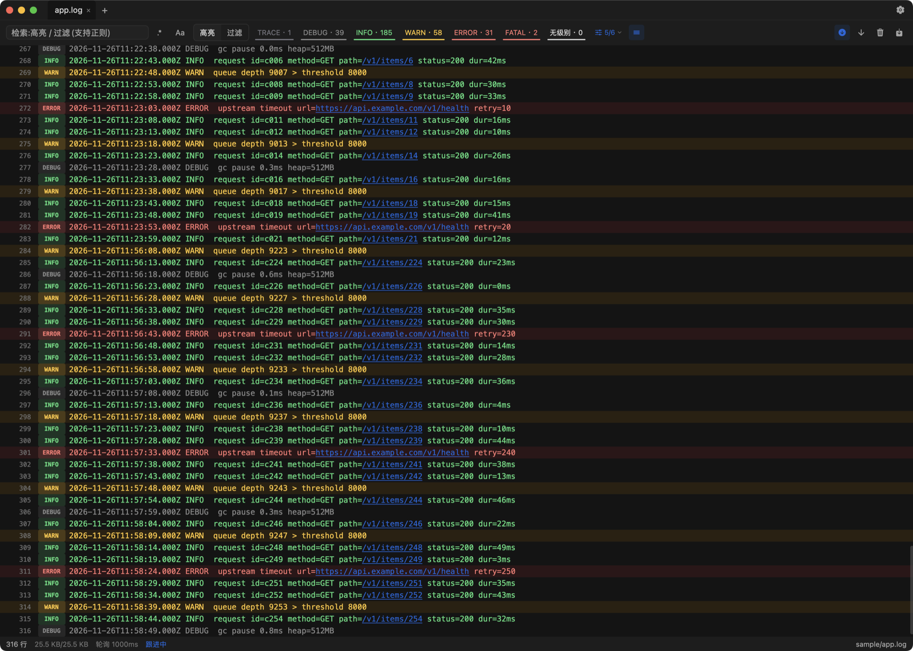
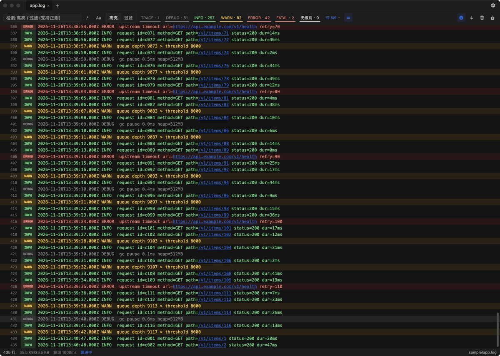

# Log Viewer

[](https://github.com/zher52/logview/actions/workflows/ci.yml)
[](LICENSE)
[](https://github.com/zher52/logview/releases)

**English** · [简体中文](README.md)

A native desktop log viewer built with **Rust + GPUI** (self-drawn UI, no WebView), inspired by the
Chrome DevTools console.

**Rust + GPUI · no WebView · Chrome DevTools console style · macOS / Windows / Linux**

Open logs from local files, SSH hosts or HTTP URLs — or run a command (`adb logcat`, `journalctl -f`,
`docker logs`…) and watch its output as a log. Regex-based level detection with colouring and filters,
highlight/filter search, auto-follow (`tail -f`), and inline link detection.

## Screenshots



Auto-follow (scrolling up pauses it; returning to the bottom resumes — recorded live):



## Features

- [x] **Four log sources**
  - Local files: `stat` polling + `seek` incremental reads
  - SSH: SFTP block reads; password / key file / pasted key / system agent; tabs for the same host
    and credentials share one session (closed 30 s after the last tab closes, reconnected on demand)
  - HTTP URL: incremental `Range` requests with built-in SSRF protection (see [Security](#security))
  - Commands: run locally or over SSH, with stdout/stderr merged into the tab; built-in presets for
    `adb logcat` (all / package / tag), `tail -F`, `journalctl -f`, `docker logs -f` and
    `kubectl logs -f`. Presets are data in the settings file and fully editable; the exit code is shown
    and an optional retry reconnects after a device or container restart
- [x] **Level detection (regex, built-in + unlimited custom profiles)**
  - 5 built-in profiles: generic words / logfmt (`level=xxx`) / bracketed `[LEVEL]` / bracketed single
    letters `[D]/[I]/[W]/[E]` (enabled by default) / bare single letters `T/D/I/W/E/V/F` (disabled by
    default to avoid false positives on the English word "I"; when enabled, `D/xxx`, bare `W` etc. work)
  - Unlimited custom profiles, evaluated in list order with **first match wins**; a rule can use a fixed
    level or `Auto` (capture-group text is mapped: `err→ERROR`, `warning→WARN`, single letters
    `d/i/w/e/t/v/f` → the matching level…)
  - The toolbar dropdown "Profiles n/m ▾" toggles profiles instantly and persists the choice
- [x] **Colouring and filtering by level**: 6 levels + unlevelled; colours are per-theme and
  customisable (level chips, log rows and the settings palette share one source), ERROR/FATAL get a red
  left bar plus background, WARN is orange; chips show live counts and toggle filters
- [x] **Multi-line records**: unlevelled continuation lines (stack traces etc.) can inherit the previous
  level for colouring and filtering; runs between two levelled lines fold to the first N lines by
  default (default 3), with a "…" suffix and an inline chevron on the preceding row. Clicking the chevron
  toggles the group; clicking the log row keeps the normal selection behaviour
- [x] **Inline ANSI colours**: SGR basic/bright, 256-colour and 24-bit truecolour, plus bold, dim,
  italic, underline, strikethrough and inverse. Control sequences are stripped at ingest, so search,
  copy, link detection and JSON detection all see plain text
- [x] **Search**: highlight mode (all rows visible, indigo highlight, match counter, `▲`/`▼`/Enter
  navigation) or filter mode (only matching rows); plain text or regex, case sensitivity
- [x] **Auto-follow**: a per-tab worker polls for appended data (1 s by default); sticky-to-bottom with
  a "↓ N new lines" floating button while scrolled up; **rotation/truncation detection** (when
  `size < offset` a separator row is inserted and following continues from 0)
- [x] **Inline links**: URLs, POSIX/Windows absolute paths and relative log paths (`xxx/yyy.log`) open
  in a new tab; in SSH tabs a clicked path reuses the current host and credentials; URLs have an
  "open in browser" context-menu action; a whole-line JSON row gets a `{}` badge and opens pretty-printed
  in a new tab
- [x] **Drag and drop**: drop files from Finder/Explorer onto the window to open them (multiple at once,
  with a drop overlay)
- [x] **System-level "Open With"**: the macOS `.app` declares `.log/.out/.err/.txt`, so Finder's
  "Open With → Log Viewer" and double-click both work; the Windows msi registers a ProgID plus
  `OpenWithProgids` (no silent default-association takeover); `install.sh` installs the Linux
  `.desktop` entry. CLI `logview file...` and `open -a 日志查看器.app file` also work.
- [x] **Code / config view**: opening `.json/.rs/.py/.js/.ts/.go/.c/.cpp/.java/.sh/.toml/.yaml/.md`
  etc. highlights it line by line (read-only); the toolbar can switch to editing and `⌘S` saves
  (line numbers + syntax colouring, no completion/LSP); files over 2 MiB open as logs instead.
  **Markdown**: rendered preview in read-only mode (headings, lists, tables, quotes, code blocks,
  links; fenced blocks are syntax-highlighted), "Edit" shows the source; local images resolve relative
  to the document directory and decode `%20` and similar escapes, missing files become a
  "⚠ image missing" placeholder; previews are capped at 512 KiB and fall back to source highlighting
- [x] **Large-file friendly**: virtual scrolling renders only visible rows; the initial head load is
  4 MB by default, and the banner offers "Load all" and "Jump to end" (2 MB tail, row-aligned). Command
  sources get the same history, pause and seek semantics through a local spool
- [x] **Themes**: follows the system light/dark appearance live; visuals are built on antd v5 design
  tokens (primary colour, neutral scale, semantic colours, radii, spacing)
- [x] **Custom accent colour**: Settings → Appearance → Accent colour (antd blue by default; dark theme
  switches to the dark variant; all primary-coloured elements follow)
- [x] **Icon toolbar**: follow / jump to end / clear / load all / wrap / profiles / edit-save are all
  26 px icon buttons with tooltips, so narrow windows no longer overflow; built-in SVGs (an Ionicons
  subset) are registered in `assets.rs`, other paths fall back to gpui-kit icons
- [x] **Narrow-window adaptation**: level chips degrade in three steps based on measured width —
  `INFO · 153` → `I · 153` → `I` (initial only) — and restore full names when there is room; the
  minimum window width is 960
- [x] **Timestamps (off by default)**: Settings → Appearance → "Show timestamps" puts the row's local
  time (`HH:MM:SS.mmm`) on the left. The time is taken by the worker when a chunk arrives, so history
  brought in by the initial head load / load all / jump to end has no trustworthy output time and
  leaves the column blank; the toggle affects display only, never collection. Formatting uses `chrono`
  (`clock` + `std` only, reusing an existing transitive dependency)
- [x] **Adjustable font size**: separate UI and log font sizes; log line height follows, and other UI
  elements scale from the configured base size
- [x] **Adjustable fonts**: separate UI and log font families by installed system font name (empty =
  follow the system); CJK glyphs fall back through the system stack
- [x] **Chinese / English / Русский UI**: switch instantly under Settings → Appearance → "Interface
  language". Copy uses semantic IDs (`common.cancel`), translations live in `locales/{zh,en,ru}.toml`
  and need no Rust changes; `build.rs` verifies that the three files have identical keys and
  `cargo test` verifies that every ID used in the source exists. Counts use per-language plural forms
  (Russian 1 строка / 2 строки / 5 строк)
- [x] **Profile management**: Settings → Profiles has "Import JSON / Export JSON / Restore built-in
  defaults" at the bottom of the left column; each built-in profile also has "Restore default" next to
  its title
- [x] **Settings page (VS Code style)**: a separate Settings tab with categories and search on the left
  and grouped settings on the right; changes apply and save immediately, with no Save button. Level
  profiles are managed in a list + rule-editor two-pane layout
- [x] **About & update check**: Settings → About shows the version, build commit (`build.rs` injects it
  from git, `unknown` without `.git`), licence, project links and the open-source component list (with
  the full third-party notices), and copies "version + build + platform" for bug reports. "Check for
  updates" queries GitHub Releases on demand, sending only the version number and no local data; when a
  newer release exists it opens the download page without downloading or replacing the app
- [x] **Other**: merged title bar (macOS: tabs and traffic lights share a row, dragging the tab bar
  moves the window), close button on tab hover, multiple tabs (close others from the context menu),
  recents (adjustable count, remove one, clear all, scrollable), ring-buffered line limit, JSON
  import/export of profiles, and rebindable shortcuts

## Download

Prebuilt artifacts are on [Releases](https://github.com/zher52/logview/releases):

| Platform | Artifact | Notes |
|---|---|---|
| macOS Apple Silicon (M series) | `logview-macos-arm64.dmg` | Open the dmg and drag "日志查看器" into Applications; the same-named `.zip` is a no-mount fallback |
| macOS Intel | `logview-macos-x86_64.dmg` | Same as above, for Intel Macs from 2020 and earlier |
| Windows | `logview-windows-x64.msi` / `logview.exe` (experimental) | The msi installs per user (Start-menu entry + "Open With"); the exe is a single-file portable build, also shipped as `logview-windows.zip` |
| Linux x86_64 | `logview-linux-x86_64.tar.gz` / `logview-x86_64.AppImage` / `logview-linux-x86_64` (experimental) | The tarball contains `.desktop`, an icon and `install.sh`; the AppImage runs on double-click; the raw binary suits scripts and containers |

> A wrong architecture will simply fail to launch (an x86_64 build needs Rosetta on Apple Silicon):
> check with `uname -m`; M-series Macs usually report `arm64`.

> Artifacts are **ad-hoc signed and not notarised** (no paid Apple Developer account, so no Developer ID
> or notarisation). A downloaded `.app` is blocked by Gatekeeper on first launch, which is expected:
> right-click → "Open" → "Open" again, or click "Open Anyway" at the bottom of System Settings →
> Privacy & Security. Command-line equivalent:
> `xattr -dr com.apple.quarantine /Applications/日志查看器.app`.
> To verify a download, fetch `SHA256SUMS.txt` from the release page (it covers every asset) and run
> `shasum -a 256 -c SHA256SUMS.txt`, or build from source as described below.

macOS installs best from the dmg (drag into Applications, no mount point left behind); Windows ships a
per-user msi (Start menu, uninstaller and "Open With" registration) plus the single-file `logview.exe`
(with a zip); Linux offers the portable tarball, the AppImage and the raw binary. Behaviour matches the
macOS build (see [Platform support](#platform-support)), and you can always build from source.

### Linux desktop integration

```bash
tar -xzf logview-linux-x86_64.tar.gz
cd logview-linux-x86_64
./install.sh                 # installs into ~/.local (override with PREFIX=/usr/local)
./install.sh --uninstall     # remove
```

`install.sh` puts the executable, `logview.desktop` and a 256×256 icon under `$PREFIX` and refreshes the
desktop database; afterwards "Log Viewer" appears under "Open With" for `.log` / `.out` / `.err` / `.txt`
files, and `logview file` works from a terminal. The AppImage needs no installation:

```bash
chmod +x logview-x86_64.AppImage
./logview-x86_64.AppImage sample/app.log
```

## Quick start

Requires Rust **1.92+** (`rustup`, stable; keyring → zbus → oo7 in the dependency chain needs 1.92,
while macOS/Windows compile from 1.91). The first build is slow (gpui / ssh2 / reqwest / keyring);
incremental builds are fast.

```bash
git clone https://github.com/zher52/logview && cd logview
cargo run                        # opens the "open source" dialog
cargo run -- sample/app.log      # open a local file from the CLI
cargo build --release            # binary at target/release/logview
```

Demo auto-follow (in another terminal, append one line per second):

```bash
./sample/gen_log.sh sample/app.log 1
```

## Usage

### Opening a source (Ctrl/Cmd+T)

| Type | Fields | Notes |
|---|---|---|
| Local | File path | Or use **Browse…** to pick a file |
| SSH | Host / port / user / auth / remote path | Auth: password, key file (path on the server), key text (paste PEM), or ssh-agent |
| HTTP | URL / auth (none, Basic, Bearer, API key, custom header) | Public addresses only (see Security); following requires `Range` support |
| Command | Preset + parameters (local) or host + auth + preset + parameters (SSH) | Built-in adb / tail / journalctl / docker / kubectl presets; custom argv allowed; SSH commands use the "Command" tab of the SSH dialog |

With **Remember connection** enabled, credentials go to the **OS keychain** (macOS Keychain, Windows
Credential Manager, Linux Secret Service). `settings.json` only stores non-sensitive fields such as
host, port, user and path — never passwords or tokens. If the keychain is unavailable, credentials live
in memory for the current session and must be re-entered next time. Plaintext credentials from older
versions are migrated automatically at startup; on failure the plaintext is still removed and you are
asked to re-enter it. Pasted private-key text is not written to the keychain (it can exceed the Windows
2560-byte entry limit); prefer a key file.

URL credentials have two modes: **Save credentials** (keychain) and **History only** (default, sanitized
URL retained). Focusing the SSH host field expands saved servers; they can be managed under Settings →
Connection or imported from the system ssh config. The recents limit is configurable under Settings →
Connection → Recents (default 50); deleting a URL entry also removes its keychain credentials by
default.

### Command sources

Use **Command** on the welcome screen, or switch to the **Command** tab in the SSH dialog. Both share
the same presets and form.

- **Presets are data** in `command_presets` in `settings.json` (seeded on first run; new built-ins are
  appended by id). Edit argv or add your own commands without changing code. Empty parameters are
  dropped together with their adjacent flag.
- **Local commands** are executed directly by argv, without a shell; the executable is looked up on
  `PATH` with a clear error when missing.
- **SSH commands** run in the remote login shell (`sh -c`) with each argument single-quoted, so pipes
  and redirection work. This is equivalent to typing the command in a terminal; there is no argv-level
  sandbox or whitelist.
- **Semantics**: stderr is merged into the same tab. Output is also written to a local temporary
  spool (128 MB cap, mode 0600), so pausing or scrolling away never loses lines and **Load all** /
  **Jump to end** work exactly like file sources. Clearing the view also clears the spool; closing the
  tab or quitting deletes it, and leftovers from crashes are swept on the next start (macOS:
  `~/Library/Caches/logview/spool/`, Windows/Linux: `logview/spool/` under the system cache dir).
- **Exit & reconnect**: the exit code is shown at the bottom, and **Retry after exit** reopens with
  backoff (useful for device or container restarts); output from before the reconnect stays in the spool.
- **Auth**: SSH commands reuse the SSH file source credentials and keychain entry for the same
  `user@host:port`.

### Level profiles

```jsonc
// the configs array in settings (import/export uses the same format)
[
  {
    "id": "my-nginx",
    "name": "my-nginx",
    "enabled": true,
    "built_in": false,
    "rules": [
      { "auto": true,  "level": 2, "regex": "(?:^|\\s)severity=(\\w+)", "flags": "i" },
      { "auto": false, "level": 4, "regex": "\\b5\\d\\d\\b",        "flags": "" }
    ]
  }
]
```

- `auto: true` maps capture group 1 text to a level (`err/error→ERROR`, `warn/warning→WARN`,
  `fatal/critical/panic→FATAL`, `trace/verbose→TRACE`, `debug/dbg→DEBUG`, `info/notice→INFO`)
- `auto: false` uses the fixed `level` (0=TRACE 1=DEBUG 2=INFO 3=WARN 4=ERROR 5=FATAL)
- Enabled profiles are evaluated in order and **the first match wins**; the toolbar dropdown toggles
  them per tab

### Search

| Control | Behavior |
|---|---|
| Highlight | All rows stay visible; matches get an indigo highlight and the counter; `▲`/`▼`/Enter cycle |
| Filter | Only matching rows are shown (intersected with level filters); the box shows `visible/total` |
| `Aa` | Case sensitive |
| `.*` | Regex mode (invalid patterns show an inline error without breaking the view) |

### Shortcuts

Rebind actions under Settings → Shortcuts: click **Edit**, then press a combination with a modifier.
One action per combination; conflicts **swap** bindings. Each action can also be reset individually.
Bindings live in the `shortcuts` field of `settings.json`.

| Key | Action |
|---|---|
| Ctrl/Cmd+T | Open a source |
| Ctrl/Cmd+W | Close tab |
| Ctrl/Cmd+F | Focus search |
| Ctrl/Cmd+K | Clear screen (keeps the offset; new logs still append) |
| Ctrl/Cmd+S | Save code-view edits |
| Ctrl/Cmd+C | Copy selected log rows |
| Ctrl/Cmd+, | Open settings (applies and saves immediately) |
| Esc | Close dialogs |
| Enter (search) | Jump to the next match in highlight mode (fixed) |

**Row selection**: click a row to select it, Shift/Cmd-click to extend, right-click to copy the row or
selection; Cmd/Ctrl+C also copies. Link context menus add open-in-new-tab / open-in-browser / copy-link.

## Configuration & persistence

Settings file: macOS `~/Library/Application Support/logview/settings.json` · Linux
`~/.config/logview/settings.json` · Windows `%APPDATA%\logview\settings.json`

It contains level profiles (`configs`), level colours (`colors` / `colors_light`; 7 hex values per
theme, TRACE…FATAL/unlevelled, shared by chips and rows), search highlight colours
(`highlight_dark` / `highlight_light`, edited in the same colour table), UI/log font sizes
(`ui_font_size` / `log_font_size`), UI/log font families (`ui_font_family` / `log_font_family`, empty =
system), accent colour (`primary_color`, empty = antd blue), polling interval (`poll_ms`), line limit
(`max_lines`, ring-buffered), initial/tail load sizes (`initial_mb` / `tail_mb`), `show_line_numbers`,
`show_timestamps`, recents (`recents`) and their limit/purge policy (`recents_limit` 1–500, default 50;
`recents_purge_creds`), saved SSH hosts (`ssh_hosts`; name/host/port/user only, no credentials), and
command presets (`command_presets`; name, local/SSH, argv template, fields, resolve steps, level profile;
no credentials).

## Security

**SSRF protection (HTTP sources, enforced, not bypassable)**

1. Only `http://` / `https://` are accepted
2. DNS is resolved before the request and **every** returned address is checked; localhost, loopback,
   private and reserved ranges are rejected (IPv4: 0/8, 10/8, 100.64/10, 127/8, 169.254/16, 172.16/12,
   192.0.0/24, 192.0.2/24, 192.88.99/24, 192.168/16, 198.18/15, 198.51.100/24, 203.0.113/24, 224/4,
   240/4 etc.; IPv6: `::`, `::1`, fc00::/7, fe80::/10, 2001:db8::/32, and `::ffff:` mapped addresses
   are re-checked as IPv4)
3. The connection is pinned to a validated IP while keeping the original `Host` header, preventing DNS
   rebinding
4. Every redirect is re-validated from scratch
5. Response size is capped

As a result, **private HTTP log endpoints are unreachable** by design; use an SSH source or a local path
instead.

**Command sources**: local commands bypass the shell and execute the preset argv; SSH commands run in
the remote login shell with single-quote escaping and no command whitelist — presets are maintained by
the user, so review the command before running it. Commands inherit the process environment (local) or
the login shell environment (SSH) and never read other credentials from `settings.json`.

**Credentials**: passwords/tokens live only in session memory unless you enable **Remember
connection**; then `keyring` stores them in the OS keychain (service `io.github.zher52.logview`, matching
the macOS bundle id), with one JSON entry per `ssh|user@host:port` / `http|URL`, and settings files never
contain secrets. Old plaintext credentials are migrated at startup and the file rewritten immediately;
without a keychain (e.g. Linux without Secret Service) credentials stay in memory. Pasted private-key
text is not stored in the keychain (Windows 2560-byte entry limit). Cleanup: Settings → Connection →
saved URL credentials removes entries; deleting a recents URL also removes its keychain entry when the
purge option is on. SSH credentials are not removed with recents or saved hosts and must be deleted in
the OS keychain.

**SSH host keys**: after connecting, `~/.ssh/known_hosts` is compared; a mismatch aborts the connection
with a possible man-in-the-middle warning. Unknown hosts show host, algorithm and SHA256 fingerprint with
"trust once" or "trust and remember" (written to `known_hosts`).

No telemetry is collected; the update check sends only the version number.

## Architecture

```
UI thread (GPUI + gpui-kit; self-drawn virtual list, visible rows only)
   │ crossbeam channel → Cmd { Pause | SeekStart | SeekEnd | Stop }
   ▼                    ← Msg { Append | Replace | Partial | Complete | Truncated | NoFollow | Error }
Tail worker thread per tab (poll size → incremental reads, 1 MB chunks, ≤8 MB per tick)
   ├─ LocalSource  fs::metadata + File::seek/read
   ├─ SshSource    ssh2::Session + SFTP stat/open/seek (5 retries, then fatal)
   ├─ HttpSource   reqwest blocking + Range (pinned validated IP; redirects re-checked per hop)
   └─ Command      local child process / SSH exec (merged stdout+stderr, exit code + backoff retry)
```

| Module | Responsibility |
|---|---|
| `main.rs` | GPUI startup, window options, CLI open |
| `app_view.rs` | Tabs, toolbar (search / level chips / profile selector), virtual log view, open-source and settings dialogs, message polling, recents, shortcuts |
| `theme.rs` | antd-v5-style dark/light palettes, font size and line-height system |
| `assets.rs` | Built-in SVG icon table (Ionicons subset, including the GitHub mark) |
| `level.rs` | Level constants/aliases, `LevelConfig`/`Rule`, regex engine |
| `lines.rs` | `LineStore`: bytes → lines (split on `\n`, UTF-8 safe), counts, line limit |
| `search.rs` | Search state and matcher (text/regex, highlight ranges) |
| `links.rs` | URL/path detection, overlap resolution, JSON detection |
| `ssrf.rs` | URL validation and blocked network ranges |
| `command.rs` | Command presets, argv expansion and built-in presets |
| `source.rs` | Source open/meta/read_at, command spawn (local / SSH exec), SSH, HTTP client with pinned IP |
| `ssh_config.rs` | Import hosts from the system ssh config (skipping patterns and `Match`) |
| `session.rs` | SSH session layer: shared connections, idle auto-close, non-blocking SFTP/channel I/O, reconnect, host-key (TOFU) checks |
| `secrets.rs` | OS keychain storage, in-memory fallback |
| `store.rs` | `settings.json` read/write and legacy plaintext migration |
| `tail.rs` | Worker protocol, file/stream loops, initial/tail/full loads, rotation |
| `i18n.rs` | Semantic-ID lookups (`t` / `tf` / `td` / `tn`); translations live in `locales/*.toml` and are compiled by `build.rs` |
| `code_input.rs` | Regex input highlighting |
| `code.rs` | Code/Markdown highlighting and preview limits |

`build.rs` compiles `locales/*.toml` into `&'static str` tables at build time (verifying identical key
sets) and injects `GIT_HASH` from `git rev-parse --short=8 HEAD` (`unknown` without `.git`).

## Development

```bash
cargo build                      # debug build (dependencies at opt-level=2)
cargo clippy --all-targets       # lint
cargo test --locked              # 107 unit tests + 2 packaging checks (1 live SSH test ignored by default)
cargo run -- sample/app.log      # run with the sample log
cargo run -- sample/ansi.log     # inspect inline ANSI colours
```

`dev.sh` / `package.sh` are maintainer-local scripts and are not tracked (`.gitignore`); see
[CONTRIBUTING.md](CONTRIBUTING.md) for the contribution workflow.

- The UI is fully self-drawn with GPUI components from gpui-kit; palette tokens live in `theme.rs`.
- Level detection runs when the worker appends; after a profile change the UI re-evaluates in frames
  (`relevel_step`, 100k lines per frame).
- Design notes: [DESIGN.md](DESIGN.md); prototype: [prototype.figcraft](prototype.figcraft).

### Packaging

```bash
cargo build --release            # raw binary at target/release/logview
./scripts/make_app.sh            # (macOS) builds the .app bundle and registers file types
./scripts/make_dmg.sh            # (macOS) wraps the .app into a dmg with an Applications shortcut
./scripts/make_linux.sh          # (Linux) tarball + .desktop + icon + install.sh, optional --appimage
pwsh ./scripts/make_msi.ps1      # (Windows, WiX 3 required) produces target/logview-<version>-x64.msi
pwsh ./scripts/test_msi.ps1      # (Windows) silent install → association checks → uninstall smoke test
```

The bundle declares log/txt/out/err document types, so Finder's **Open With** works. Releases ship
`.dmg` (plus a `.zip` fallback) per architecture. Windows releases ship a per-user msi (`logview-windows-x64.msi`; installs into
`%LOCALAPPDATA%\LogViewer`, adds a Start-menu shortcut, uninstaller and ProgID plus `OpenWithProgids`
entries, with no silent default-association takeover) and a portable `logview.exe` (plus a `.zip`); CI
installs the msi silently on a Windows runner and checks the registrations before uninstalling it.
Linux artifacts are built by `scripts/make_linux.sh`: a portable tarball with `logview.desktop`
(`Exec=logview %f`), a 256×256 icon and `install.sh`, plus an AppImage; the raw `logview-linux-x86_64`
binary is published as well.

> Release artifacts are **ad-hoc signed and not notarised** (no paid Apple Developer account):
> `make_app.sh` prefers an Apple Development certificate and falls back to ad-hoc signing; the first
> launch needs right-click → "Open" or a Privacy & Security override — see [Download](#download).

Windows: after installing the msi, right-click a log file → "Open With" shows "Log Viewer" (ProgID and
`OpenWithProgids` under `HKCU\Software\Classes`, without taking over the default silently); the portable
build still works via "Choose another app → logview.exe".
Linux: the tarball contains `.desktop` (`Exec=logview %f`); after `./install.sh` the entry appears under
"Open With"; the AppImage starts through its bundled `AppRun` with no installation.

### Roadmap

Recently completed (0.3 – 0.5):

- [x] macOS `.app` bundling and file associations (`./scripts/make_app.sh`, Finder "Open With"; releases
  provide arm64 / x86_64 dmg)
- [x] Windows portable build (`logview.exe`, plus `logview-windows.zip`)
- [x] Linux packaging and desktop integration (`scripts/make_linux.sh`: tarball + `.desktop` + icon +
  `install.sh`, optional AppImage; releases include tar.gz and AppImage)
- [x] Windows installer (`logview-windows-x64.msi`): per-user install into `%LOCALAPPDATA%\LogViewer`,
  Start-menu shortcut, uninstaller and "Open With" registration; portable zip retained
- [x] Command sources (local / SSH execution, built-in adb / journalctl / docker / kubectl / tail
  presets; output spooled locally so pause and "jump to end" lose nothing)
- [x] About page and update check (version + build commit + licence + component list; the check only
  opens the download page and uploads no local data)
- [x] Code/config syntax highlighting and Markdown preview (toolbar "Edit" + `⌘S` save; local images
  resolved from the document directory)
- [x] Chinese / English / Russian UI (semantic IDs + `locales/*.toml`, compile-time key parity)
- [x] Long-line wrapping (on by default, toolbar toggle; off renders single lines)
- [x] SSH host-key verification and TOFU confirmation for unknown hosts (mismatches are rejected)
- [x] Reuse of connected SSH sessions (tabs on the same host with the same credentials share one
  session, so path links open without reconnecting; the connection closes 30 s after the last tab)
- [x] HTTP authentication (Basic / Bearer / API key / custom headers)

Planned:

- [ ] Merged multi-file view / timeline (sort across tabs by time, unified search)
- [ ] Graphical command-preset editor (currently edit `command_presets` in the settings file)
- [ ] Automatic updates (needs code signing and Apple notarisation, which are not available yet;
  "check for updates + manual download" stands in for now)

## FAQ

**CJK glyphs show as boxes?** Set the UI/log fonts separately under Settings → Appearance → Size and
fonts, or leave them empty to follow the system font. Boxes mean the chosen font has no CJK glyphs;
switch back to "follow system" or install a CJK font.

**`adb logcat` prints nothing?** Check `adb devices`; leave the device field empty to let adb choose,
and fill it when several devices are connected. If `adb` is not on `PATH`, use an absolute path in
the preset.

**Where is command history stored?** Each command tab spools output under `logview/spool/` in the
system cache directory; it is deleted on tab close or quit, truncated by "clear", and leftovers are
swept at startup. The cap is 128 MB (the oldest half is dropped). If the spool cannot be written you
only get a live preview (with a notice). Spooled log text is briefly written to disk in plain text —
clear or close the tab if the output contains secrets.

**SSH reports authentication failure?** Check the username and credentials; key-file paths refer to
the **server's** filesystem; agent auth needs `SSH_AUTH_SOCK` in the environment.

**HTTP opens with "following unsupported"?** The server ignores `Range`, so only whole-page viewing
is possible and auto-follow is disabled.

## Platform support

| Platform | Status |
|---|---|
| macOS | Primary development and verification platform; `.app` bundling and file associations work; releases provide arm64 and x86_64 dmg |
| Windows | CI build, msi packaging and silent-install smoke test (install / associations / uninstall); real desktop interaction is not yet verified, per-user and no admin required |
| Linux (X11 / Wayland) | CI build and packaging; releases ship the `.desktop` tarball, AppImage and a raw binary; desktop interaction is not fully verified |

The Windows/Linux CI jobs are experimental and do not block merges (see `.github/workflows/ci.yml` and
the Linux packaging job in `release.yml`).

## Contributing

- Repository: [github.com/zher52/logview](https://github.com/zher52/logview) (issue and PR templates
  are in place)
- Development setup, commit conventions and PR checklist: [CONTRIBUTING.md](CONTRIBUTING.md)
- Security reports: private channel only, see [SECURITY.md](SECURITY.md)
- Changes: [CHANGELOG.md](CHANGELOG.md)

To improve translations, edit `locales/en.toml` or `locales/ru.toml` — the build fails if the three
files have different keys, and `cargo test` verifies that every ID used in the source exists. Code
comments and commit messages are in Chinese; identifiers are English.

## License

[GNU AGPL-3.0](LICENSE) (SPDX: `AGPL-3.0-only`), Copyright (C) 2026 zher52.

- If you modify and distribute this program, or offer it to users over a network, you must make the
  complete corresponding source available as required by section 13 of the AGPL.
- Bundled Ionicons icons are MIT; dependency and asset notices are in
  [THIRD_PARTY_LICENSES.md](THIRD_PARTY_LICENSES.md).
- UI and log fonts are read from the operating system; no font files are distributed.