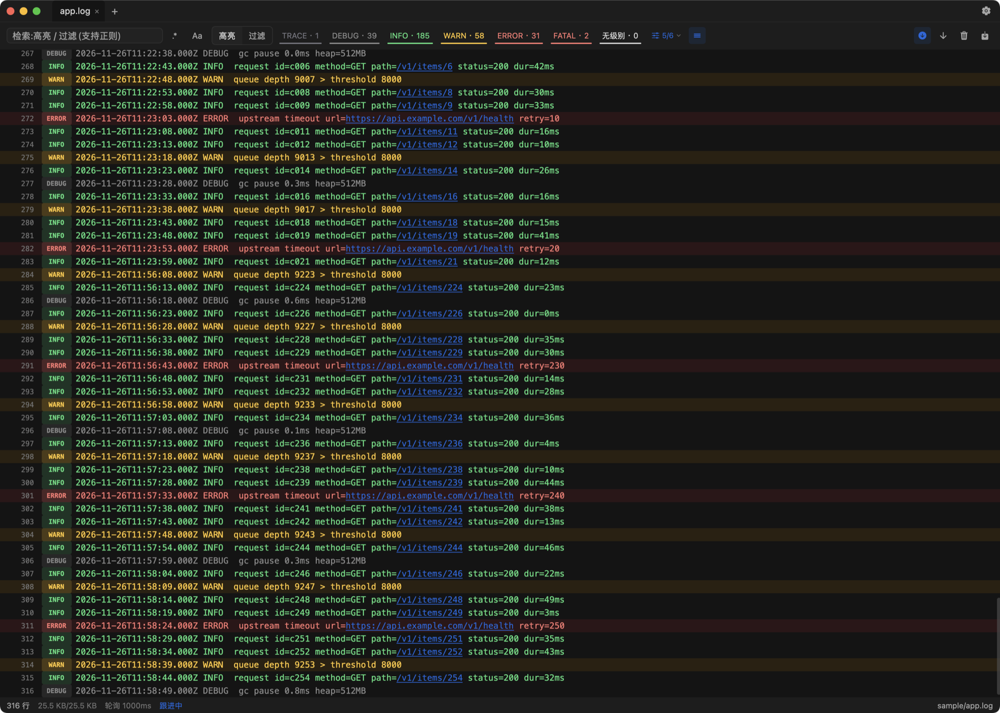
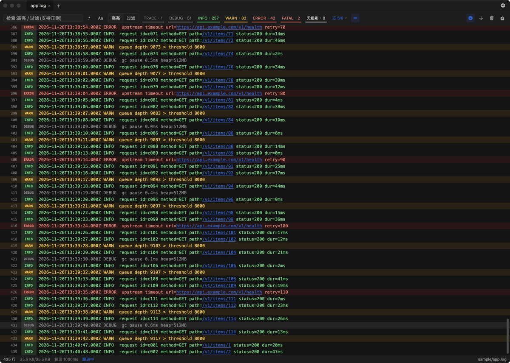

# 日志查看器

[](https://github.com/zher52/logview/actions/workflows/ci.yml)
[](LICENSE)
[](https://github.com/zher52/logview/releases)

**简体中文** · [English](README.en.md)

Rust + GPUI 原生桌面日志查看器（无 WebView），交互参考 Chrome DevTools 控制台。

**Rust + GPUI 自绘 UI · 无 WebView · 参考 Chrome DevTools 控制台风格 · 目标全平台(macOS / Windows / Linux)**

打开本地 / SSH 远端 / HTTP 链接的日志文件,或直接运行命令(`adb logcat`、`journalctl -f`、`docker logs`…)把输出当日志看,正则分析日志级别并着色筛选,支持高亮与过滤检索、自动追加(tail -f)、行内链接识别。

## 界面



自动追加(向上滚动自动暂停,回到底部继续;GIF 为实时录制):



## 功能特性

- [x] **四种日志源**
  - 本地文件:`fs.stat` 轮询 + seek 增量读
  - SSH 远端:SFTP 分块读,支持密码 / 私钥文件 / 私钥文本 / 系统 agent 认证
  - HTTP URL:`Range` 请求增量拉取,内置 SSRF 防护(见[安全说明](#安全说明))
  - 命令:本地直接执行或经 SSH 执行,stdout/stderr 合并入标签;内置 `adb logcat`(全量 / 包名 / 标签)、`tail -F`、`journalctl -f`、`docker logs -f`、`kubectl logs -f` 预设,预设是设置文件里的数据,可自定义;退出码提示与可选自动重试,适配设备重连、远端服务重启
- [x] **级别分析(正则,默认 + 自定义多配置)**
  - 内置 5 套配置:通用单词 / logfmt(`level=xxx`)/ 方括号 `[LEVEL]` / 方括号单字母 `[D]/[I]/[W]/[E]`(默认启用),单字母级别 `T/D/I/W/E/V/F`(默认关闭,防止英文 "I" 误报;启用后 `D/xxx`、裸 `W` 等格式均可识别)
  - 自定义配置数量不限,按列表顺序判定、首中即停;规则可固定级别或 `Auto`(捕获组文本自动映射:`err→ERROR`、`warning→WARN`、**单字母 `d/i/w/e/t/v/f`→对应级别**…)
  - 主页工具栏「配置 n/m ▾」下拉即时启停(与设置联动并持久化)
- [x] **按级别着色与筛选**:6 级别 + 无级别;颜色暗/亮主题各一套可自定义(级别 chips、日志行、设置色板三者一致),ERROR/FATAL 红色左条 + 底色,WARN 橙色;chips 带实时计数,点击开关筛选
- [x] **多行记录聚合与折叠**:无级别续行(异常堆栈等)可跟随上一条已知级别着色与筛选;两条有级别行之间的续行可按设置默认收起(保留行数默认 3),超过时末行追加「…」,行首图标切换展开/收起,点日志行仍保留原有点击行为
- [x] **行内 ANSI 颜色**:解析 SGR 基础色/亮色、256 色与 24 位真彩色,支持粗体、暗淡、斜体、下划线、删除线和反显;控制序列在入库时剥离,检索、复制、链接识别与 JSON 检测均按纯文本工作
- [x] **检索**:高亮模式(全部可见 + 靛蓝底/加粗高亮 + 匹配计数 + ▲▼/Enter 跳转)/ 过滤模式(只显示匹配行);关键字与正则、大小写开关
- [x] **自动追加**:每标签独立线程轮询增量读取(默认 1s);粘底跟随,上滚自动暂停并出现「↓ N 条新日志」浮动按钮;**轮换/截断检测**(size < offset 时插入分隔行并从 0 继续跟随)
- [x] **链接识别**:行内 URL、POSIX/Windows 绝对路径、相对日志路径(`xxx/yyy.log`)可点击 → 新标签页打开;SSH 标签内点击路径继承当前主机/凭据;URL 右键可「在浏览器打开」;整行 JSON 带 `{}` 徽标 → pretty 新标签打开
- [x] **拖入打开**:把文件从 Finder/资源管理器拖进窗口即打开(支持一次拖入多个,拖入时窗口有覆盖提示)
- [x] **系统级打开集成**:macOS 打包为 .app 后,可在 Finder 右键 `.log/.out/.err/.txt` →「打开方式 → 日志查看器」,或双击关联文件;Windows msi 安装后写入「打开方式」注册(ProgID + `OpenWithProgids`,不静默抢占默认关联);Linux `install.sh` 安装 `.desktop` 后同样可在「打开方式」中选择。也支持 `open -a 日志查看器.app 文件` 与 CLI `logview 文件...`。
- [x] **代码/配置文件视图**:打开 `.json/.rs/.py/.js/.ts/.go/.c/.cpp/.java/.sh/.toml/.yaml/.md` 等文件时按代码格式逐行高亮(只读),工具栏可切换「编辑」并用 `⌘S` 保存(行号 + 语法着色,不做补全/LSP);超过 2 MiB 的文件按日志文件打开,不进代码视图。**Markdown**:只读态直接渲染预览(标题/列表/表格/引用/代码块/链接,围栏代码块按语言着色),点「编辑」显示源码;本地图片按文档所在目录解析并解码 `%20` 等转义,指向不存在文件的图片改写为 `⚠ 图片缺失:路径`;预览上限 512 KiB,超出回落源码着色
- [x] **大文件友好**:虚拟滚动只渲染可见行;初始加载头部(默认 4MB),banner 提供「加载全部 / 跳到末尾(取尾部 2MB,行对齐)」。命令源通过本机临时缓存获得同样的历史、暂停与跳转语义
- [x] **界面主题**:自动跟随系统亮暗模式并实时切换;整体视觉基于 antd v5 设计令牌(主色/中性色阶/语义色/圆角/间距体系)构建
- [x] **主题色可自定义**:设置 → 外观与显示 → 主题色(默认 antd 蓝;暗色主题自动切换深色变体,所有主色元素跟随)
- [x] **图标化的工具栏**:跟进/跳尾/清屏/加载全部/自动换行/分析配置/编辑保存等动作一律用图标按钮(26px 定宽 + 悬停说明),窄窗口不再把工具栏撑爆;内置 SVG 图标(ionicons 子集)登记在 `assets.rs` 的表里,其余路径回退到 gpui-kit 自带图标库
- [x] **窄窗口自适应**:级别 chips 按实测宽度三档退让 —— `INFO · 153` → `I · 153` → `I`(仅首字母),空间足够时自动恢复完整名称;窗口最小宽度 960
- [x] **时间戳显示(默认关闭)**:设置 → 外观与显示 → 「显示时间戳」开启后,日志行最左侧显示该行的本地时间(`HH:MM:SS.mmm`)。时间在跟随读取到数据块时打点(worker 侧),因此「启动时头部预读 / 加载全部 / 跳到末尾」带进来的历史行没有可信的输出时间,该列留空占位;开启只影响展示,不影响采集。格式化为静态小依赖 `chrono`(仅 `clock`+`std` 特性,复用已有传递依赖)。
- [x] **字号可设置**:设置中可调「界面字号」与「日志字号」(日志行高随之变化);不同大小的 UI 元素按设置的基准字号按比例缩放
- [x] **字体可设置**:界面字体与日志字体可分别指定系统已安装的字体名(留空 = 跟随系统),中文由系统字体栈回退
- [x] **中文 / English / Русский 界面**:设置 → 外观与显示 →「界面语言」即时切换。文案用语义 ID(如 `common.cancel`),译文在 `locales/{zh,en,ru}.toml`,改翻译不必动 Rust;`build.rs` 校验三语键一致,`cargo test` 校验源码里的 ID 是否存在。计数按语言变格(俄语 1 строка / 2 строки / 5 строк)
- [x] **分析配置管理**:设置 → 分析配置,左栏底部提供「导入 JSON / 导出 JSON / 恢复内置默认」;单个内置配置标题旁也有「恢复默认」,规则被误改后可一键还原
- [x] **设置页(VS Code 风格)**:独立「设置」标签页,左侧分类与搜索、右侧分组设置项;改动即时生效并自动保存,不设「保存」按钮。级别配置用「列表 + 规则编辑」双栏管理
- [x] **关于与检查更新**:设置 → 关于 显示版本号与构建提交(`build.rs` 从 git 注入,无 `.git` 时为 `unknown`)、许可证、项目链接与所用开源组件清单(含完整第三方声明入口),并可一键复制「版本 + 构建 + 平台」用于报障;「检查更新」向 GitHub Releases 查询最新版本(手动触发,只发送版本号,不上报任何本地数据),有新版本时直接打开下载页,不自行下载或替换程序
- [x] **其他**:融合标题栏(macOS:标签栏与红绿灯同一行,拖动标签栏移动窗口)、标签悬停显示关闭按钮、多标签(右键关闭其他)、最近打开(可调保存条数、单条移除与一键清除、超出高度可滚动)、行数上限环形丢弃、配置导入/导出 JSON、快捷键

## 下载

预编译产物在 [Releases](https://github.com/zher52/logview/releases)：

| 平台 | 产物 | 说明 |
|---|---|---|
| macOS Apple Silicon（M 系列） | `logview-macos-arm64.dmg` | 打开 dmg，把「日志查看器」拖进「应用程序」；同名 `.zip` 为免挂载的备用包 |
| macOS Intel | `logview-macos-x86_64.dmg` | 同上，适用于 2020 年及更早的 Intel Mac |
| Windows | `logview-windows-x64.msi` / `logview.exe`（实验性） | msi 每用户安装（开始菜单 + 「打开方式」）；exe 为单文件便携版，另附 `logview-windows.zip` |
| Linux x86_64 | `logview-linux-x86_64.tar.gz` / `logview-x86_64.AppImage` / `logview-linux-x86_64`（实验性） | 便携包含 `.desktop`、图标与 `install.sh`；AppImage 双击即用；裸二进制适合脚本或容器 |

> 架构不对会直接打不开（Apple Silicon 上跑 x86_64 包需要 Rosetta）：用 `uname -m` 确认，M 系列通常为 `arm64`。

> 产物是 **ad-hoc 签名、未经公证** 的（没有付费 Apple 开发者账号，拿不到 Developer ID 与公证资格）。
> 从浏览器下载的 `.app` 首次打开会被 Gatekeeper 拦下，属预期行为：右键 →「打开」→ 再点「打开」，
> 或到「系统设置 → 隐私与安全性」底部点「仍要打开」；命令行等效：
> `xattr -dr com.apple.quarantine /Applications/日志查看器.app`。
> 不放心可下载 Release 页的 `SHA256SUMS.txt`（覆盖全部资产），执行 `shasum -a 256 -c SHA256SUMS.txt` 批量核对；也可按下面的步骤从源码构建。

macOS 推荐用 dmg 安装（拖入「应用程序」即可，不会残留挂载点）；Windows 提供 msi 安装包（每用户安装，含开始菜单、卸载与「打开方式」注册）和单文件 `logview.exe`（另附 zip）；
Linux 便携包、AppImage 与裸二进制均可直接取用。
功能与 macOS 版本一致（见[平台支持](#平台支持)），也可以直接按下方源码构建。

### Linux 桌面集成

```bash
tar -xzf logview-linux-x86_64.tar.gz
cd logview-linux-x86_64
./install.sh                 # 安装到 ~/.local（可 PREFIX=/usr/local 覆盖）
./install.sh --uninstall     # 卸载
```

`install.sh` 把可执行文件、`logview.desktop` 与 256×256 图标装进 `$PREFIX`，并刷新桌面数据库；
之后即可在文件管理器右键 `.log` / `.txt` →「打开方式」中选择「日志查看器」，或命令行 `logview 文件`。
AppImage 无需安装：

```bash
chmod +x logview-x86_64.AppImage
./logview-x86_64.AppImage sample/app.log
```

## 快速开始

要求 Rust **1.92+**(`rustup` 安装 stable;依赖链中 keyring → zbus → oo7 需要 1.92,macOS/Windows 自 1.91 起可编译)。首编较慢(gpui / ssh2 / reqwest / keyring),之后增量编译很快。

```bash
git clone https://github.com/zher52/logview && cd logview
cargo run                        # 启动,弹出"打开日志源"对话框
cargo run -- sample/app.log      # CLI 直达打开本地文件
cargo build --release            # 产物 target/release/logview
```

演示自动追加(另开终端,每秒追加一行):

```bash
./sample/gen_log.sh sample/app.log 1
```

## 使用指南

### 打开日志源(Ctrl/Cmd+T)

| 类型 | 字段 | 说明 |
|---|---|---|
| 本地 | 文件路径 | 也可点「浏览…」调系统文件对话框 |
| SSH | 主机 / 端口 / 用户名 / 认证方式 / 远端路径 | 认证方式:密码、私钥文件(服务器本地路径)、私钥文本(粘贴 PEM)、系统 agent |
| HTTP | URL / 认证方式(无 / Basic / Bearer / API Key / 自定义请求头) | 需公网地址(见安全说明);跟随依赖服务器支持 `Range` |
| 命令 | 预设 / 参数(本地)或 主机 + 认证 + 预设 / 参数(SSH) | 内置 adb / tail / journalctl / docker / kubectl 预设,也可改 argv 自定义;SSH 命令在现有 SSH 对话框里切「命令」分页 |

「记住连接」勾选后,凭据写入**操作系统钥匙串**(macOS Keychain / Windows 凭据管理器 / Linux Secret Service);设置文件只保存主机、端口、用户名、路径等非敏感字段,永不写入密码或 token。钥匙串不可用时凭据仅在本次会话内存中生效,下次连接需重新输入。旧版本保存的明文凭据会在启动时自动迁移:迁移成功则清除文件中的明文;迁移失败同样清除明文并退回手动输入。SSH 私钥正文(粘贴 PEM)体积可能超过 Windows 凭据单条上限,不写入钥匙串。

URL 源的凭据分两档:**保存凭据**(写入钥匙串)与**仅记录历史**(默认,只留脱敏后的地址)。SSH 主机输入框聚焦即展开已保存的服务器列表,设置「连接」里可增删改这些主机,也可从系统 ssh 客户端配置批量导入。最近打开最多保留的条数在「设置 → 连接 → 最近打开」调整(默认 50 条);删除 URL 记录时默认同时清除其钥匙串凭据。

### 命令源

欢迎页点「命令」,或打开 SSH 对话框后切到「命令」分页。两者共用同一套预设与表单。

- **预设即数据**:内置预设写在 `settings.json` 的 `command_presets` 里(首次启动自动写入,后续新增内置项按 id 追加),可以直接改 argv、加自己的命令,不需要改代码。参数形如 `["adb", "-s", "${serial}", "logcat", "-v", "threadtime"]`,值为空的参数会连同紧邻的开关一起丢弃。
- **本地命令按 argv 直接执行**,不经 shell;可执行文件按 `PATH` 查找,找不到会给出明确提示。
- **SSH 命令由远端登录 shell 执行**(`sh -c`),参数逐个单引号转义,因此可以用管道、重定向;这也意味着它和你在终端里敲命令等价,不提供 argv 级别的最小权限保证。
- **语义**:stderr 合并进同一标签;输出同时写入本机临时缓存(spool,默认上限 128MB,权限 0600),因此暂停/取消跟随不会丢日志,「加载全部」和「跳到末尾」与文件源一样可用。清屏会同时清掉缓存;关闭标签或退出应用时删除缓存,异常退出留下的文件在下次启动时清理。缓存目录:macOS `~/Library/Caches/logview/spool/`,Windows/Linux 为系统缓存目录下的 `logview/spool/`。
- **退出与重连**:进程退出时标签底部显示退出码,勾选「退出后重试」后按退避自动重开(适合 `adb logcat` 设备重连、`docker logs -f` 容器重启);重连前的输出仍保留在缓存里。
- **认证**:SSH 命令复用 SSH 文件源的认证方式与钥匙串条目(同一 `用户@主机:端口`),无需重复输入。

### 级别配置

数据模型:

```jsonc
// 设置中的 configs 数组(导入/导出即此格式)
[
  {
    "id": "my-nginx",
    "name": "my-nginx",
    "enabled": true,
    "built_in": false,
    "rules": [
      { "auto": true,  "level": 2, "regex": "(?:^|\\s)severity=(\\w+)", "flags": "i" },
      { "auto": false, "level": 4, "regex": "\\b5\\d\\d\\b",        "flags": "" }
    ]
  }
]
```

- `auto: true` → 取捕获组 1 的文本映射级别(`err/error→ERROR`、`warn/warning→WARN`、`fatal/critical/panic→FATAL`、`trace/verbose→TRACE`、`debug/dbg→DEBUG`、`info/notice→INFO`)
- `auto: false` → 使用固定 `level`(0=TRACE 1=DEBUG 2=INFO 3=WARN 4=ERROR 5=FATAL)
- 多套配置同时启用时按列表顺序判定,**首中即停**;主页工具栏下拉可临时启停

### 检索

| 项 | 说明 |
|---|---|
| 高亮模式 | 全部行可见,匹配处高亮底色(默认節蓝,可在「颜色管理」调整,文字自动取对比色并加粗);显示匹配计数;`▲`/`▼`/Enter 循环跳转 |
| 过滤模式 | 只显示匹配行(与级别筛选取交集);搜索框显示 `可见/总数` |
| `Aa` | 区分大小写 |
| `.*` | 正则模式(非法正则显示红字提示,不影响现有视图) |

### 快捷键

设置 → 快捷键 里可对下表「可改」项目点「修改」后按下新组合键(需带 ⌘/Ctrl 等修饰键),一键只绑一个动作,撞键会与对方**互换**;也可单条「恢复默认」。绑定写入 `settings.json` 的 `shortcuts` 字段。

| 键 | 作用 |
|---|---|
| Ctrl/Cmd+T | 打开日志源 |
| Ctrl/Cmd+W | 关闭标签 |
| Ctrl/Cmd+F | 焦点到搜索框 |
| Ctrl/Cmd+K | 清屏(保留 offset,新日志继续追加) |
| Ctrl/Cmd+S | 保存代码视图的修改 |
| Ctrl/Cmd+C | 复制选中的日志行 |
| Ctrl/Cmd+, | 打开设置页(改动即时生效,自动保存) |
| Esc | 关闭对话框 |
| Enter(搜索框) | 高亮模式跳到下一处匹配(固定) |

**行选中与复制**:单击日志行选中该行(高亮底色),Shift/Cmd+点击扩展选区,右键菜单提供「复制整行 / 复制选中 N 行」,Cmd/Ctrl+C 也可复制。链接上的右键菜单额外提供「在新标签页打开 / 在浏览器打开 / 复制链接文本」。

## 配置与持久化

设置文件位置:macOS `~/Library/Application Support/logview/settings.json` · Linux `~/.config/logview/settings.json` · Windows `%APPDATA%\logview\settings.json`

内容:级别配置 `configs`、级别颜色 `colors` 与 `colors_light`(暗/亮主题各 7 个 hex,顺序 TRACE…FATAL/无级别;级别 chips 与日志行共用同一来源保证一致)、**搜索高亮颜色 `highlight_dark`/`highlight_light`**(暗/亮主题各一,在设置「颜色管理」表格中与级别配色一起编辑)、**`ui_font_size`/`log_font_size` 字号**(界面元素按基准比例缩放,日志行高随字号变化)、**`ui_font_family`/`log_font_family` 字体**(留空 = 跟随系统;填系统已安装的字体名,界面与日志可分别指定)、**`primary_color` 主题色**(空 = antd 蓝,暗色主题自动用深色变体)、`poll_ms` 轮询间隔、`max_lines` 行数上限(超出环形丢弃最旧行并计数)、`initial_mb`/`tail_mb` 初始与尾部加载上限、`show_line_numbers`、`recents` 最近打开、`recents_limit` 最近打开保存条数(默认 50,范围 1–500)、`recents_purge_creds` 删除 URL 记录时是否清除对应钥匙串凭据(默认开启)、`ssh_hosts` 已保存的 SSH 主机(只含名称/主机/端口/用户名,不含凭据)、`command_presets` 命令预设(名称 / 本地或 SSH / argv 模板 / 字段 / 预解析步骤 / 关联级别配置;不含凭据)。

## 安全说明

**SSRF 防护(HTTP 源,强制策略,不可绕过)**

1. 仅允许 `http://` / `https://` 协议
2. 请求前解析 DNS,对**所有**解析地址逐个校验,拒绝 localhost、环回、私有与保留网段(IPv4:0/8、10/8、100.64/10、127/8、169.254/16、172.16/12、192.0.0/24、192.0.2/24、192.88.99/24、192.168/16、198.18/15、198.51.100/24、203.0.113/24、224/4、240/4 等;IPv6:`::`、`::1`、fc00::/7、fe80::/10、2001:db8::/32、`::ffff:` 映射段回查 v4)
3. 连接固定到已校验 IP + 原 Host 头,防 DNS rebinding
4. 重定向每一跳重新走完整校验
5. 响应大小有上限

因此**内网 HTTP 日志地址无法访问**;此类场景请使用 SSH 源或本地路径。

**命令源**:本地命令不经过 shell,直接 `exec` 预设里的 argv;SSH 命令交给远端登录 shell 执行,工具只做单引号转义,不做命令白名单——预设由使用者自己维护,运行前请确认命令内容。命令继承本进程环境变量(本地)或登录 shell 环境(SSH),不会读取 `settings.json` 里的其他凭据。

**凭据**:密码/口令/token 默认只存于本次会话内存(用于保持连接与「SSH 内打开路径」);勾选「记住连接」后由 `keyring` 写入系统钥匙串(服务名 `io.github.zher52.logview`,与 macOS 包标识一致),条目按 `ssh|用户@主机:端口` / `http|URL` 聚合为一条 JSON,设置文件始终不含凭据。启动时会把旧版明文凭据自动迁移进钥匙串并立即改写配置文件;钥匙串不可用(如 Linux 无 Secret Service)时退回仅内存 + 手动输入,不落盘。SSH 私钥正文不写入钥匙串(Windows 单条 2560 字节上限),建议改用私钥文件方式。清理入口:设置「连接 → 已保存的 URL 凭据」可逐条删除(同时删钥匙串条目);欢迎页最近打开对单条点「×」或点「清除」(两步确认,确认前可取消)时,若「删除 URL 记录时清除凭据」开启,对应 URL 条目会被一并删除。SSH 凭据不随最近记录或已保存主机删除,目前需在系统钥匙串中手动移除。

**SSH 主机密钥**:连接后读取 `~/.ssh/known_hosts` 比对服务器密钥,与已有记录不一致会直接拒绝连接并提示可能的中间人攻击;未知主机会弹窗显示主机、算法与 SHA256 指纹,可选择「仅本次信任」或「信任并记住」(写入 `known_hosts`)。

## 架构

```
UI 主线程(GPUI + gpui-kit;自绘虚拟滚动,只渲染可见行)
   │ crossbeam channel → Cmd { Pause | SeekStart | SeekEnd | Stop }
   ▼                    ← Msg { Append | Replace | Partial | Complete | Truncated | NoFollow | Error }
Tail Worker 线程 × 每标签(轮询 size → 分块增量读,1MB/块,每周期 ≤8MB)
   ├─ LocalSource  fs::metadata + File::seek/read
   ├─ SshSource    ssh2::Session + SFTP stat/open/seek(断线报错,5 次重试后标致命)
   ├─ HttpSource   reqwest blocking + Range(固定已校验 IP;手动重定向逐跳复检)
   └─ Command      本地 child process / SSH exec(合并 stdout+stderr,退出码 + 退避重试)
```

| 模块 | 职责 |
|---|---|
| `main.rs` | GPUI 应用启动、窗口参数、CLI 直达 |
| `app_view.rs` | 主视图:标签栏、工具栏(检索/级别 chips/配置选择器)、日志区虚拟滚动与着色、打开源/设置对话框、消息轮询、最近打开、快捷键 |
| `theme.rs` | antd v5 风格暗/亮双配色令牌、字号与行高系统 |
| `assets.rs` | 内置图标 SVG 表(ionicons 子集,含 GitHub 标志,工具栏/设置用它),其余路径回退到 gpui-kit 图标库 |
| `code_input.rs` | 正则代码框的词法着色 |
| `level.rs` | Level 常量与别名映射、LevelConfig/Rule、Engine(正则编译与逐行判定) |
| `lines.rs` | LineStore:字节流→行(按 `\n` 切分,天然 UTF-8 断字安全)、计数、行数上限 |
| `search.rs` | 检索状态机与匹配器(文本/正则,高亮区间) |
| `links.rs` | URL/路径识别与重叠消解、JSON 行探测 |
| `ssrf.rs` | URL 安全校验与网段表 |
| `command.rs` | 命令预设数据模型(argv 模板 / 字段 / 预解析 / 级别配置关联)、argv 展开与内置预设 |
| `source.rs` | 三种文件源 open/meta/read_at、命令源 spawn(本地 / SSH exec)、SSH 连接、HTTP client 固定 IP 与重定向 |
| `ssh_config.rs` | 解析系统 ssh 客户端配置,导入已保存的 SSH 主机(跳过通配与 Match) |
| `secrets.rs` | 凭据存取:系统钥匙串优先,不可用退回仅内存 |
| `store.rs` | settings.json 读写、旧版明文凭据迁移 |
| `tail.rs` | worker 协议与轮询循环、初始/尾部/全量加载、轮换;命令源为流式模式(合并读取、退出重试) |

`build.rs`:构建期把 `locales/*.toml` 编译成 `&'static str` 查表(校验三语键集合一致),并用 `git rev-parse --short=8 HEAD` 注入 `GIT_HASH`(无 `.git` 时为 `unknown`)。

## 开发

```bash
cargo build                      # 调试构建(依赖以 opt-level=2 编译,UI 流畅)
cargo clippy --all-targets       # lint
cargo test --locked              # 100 项单元测试 + 2 项打包校验
cargo run -- sample/app.log      # 运行并打开示例日志
cargo run -- sample/ansi.log     # 查看行内 ANSI 颜色示例
```

`dev.sh` / `package.sh` 属于维护者本机工作流,不在版本库中(已在 `.gitignore`);
贡献流程见 [CONTRIBUTING.md](CONTRIBUTING.md)。

- UI 全部由 GPUI 自绘,组件来自 gpui-kit,配色令牌在 `theme.rs`(antd v5 令牌)
- 逐行级别判定发生在 worker 追加时;配置变更后由 UI 分帧重判定(`relevel_step`,10 万行/帧)
- 设计文档见 [DESIGN.md](DESIGN.md),原型源文件 [prototype.figcraft](prototype.figcraft)

### 打包

```bash
cargo build --release            # 裸二进制 target/release/logview
./scripts/make_app.sh            # (macOS)生成 日志查看器.app 并注册文件类型(版本号读 Cargo.toml)
./scripts/make_dmg.sh            # (macOS)把 .app 打成 dmg(内含拖入「应用程序」的快捷方式)
./scripts/make_linux.sh          # (Linux)便携包 tar.gz + .desktop + 图标 + install.sh,可加 --appimage
pwsh ./scripts/make_msi.ps1      # (Windows,需 WiX 3)产出 target/logview-<version>-x64.msi
pwsh ./scripts/test_msi.ps1      # (Windows)msi 静默安装 → 校验关联 → 卸载的冒烟测试

# 交叉构建另一种架构(产物同样在 target/日志查看器.app)
TARGET=aarch64-apple-darwin ./scripts/make_app.sh   # Apple Silicon
TARGET=x86_64-apple-darwin  ./scripts/make_app.sh   # Intel
```

> 维护者本机的 `package.sh` 额外负责签名与体积校验,不入库;发布构建以 `scripts/make_app.sh` 为准。

`make_app.sh` 生成 `.app` bundle 并在 `Info.plist` 声明文档类型(log/txt/out/err),
随后 `lsregister` 刷新注册 —— Finder 右键日志文件即可在「打开方式」中看到 **日志查看器**。
拖入窗口与 CLI(`logview 文件...`)同样支持多文件。

> 发布产物是 **ad-hoc 签名、未经公证** 的（无付费 Apple 开发者账号）：`make_app.sh` 会优先找
> Apple Development 证书，找不到就用 ad-hoc 签名；首次打开需右键「打开」或到系统设置放行，详见[下载](#下载)。

Windows:msi 安装后右键日志文件 →「打开方式」即可看到「日志查看器」(写入 `HKCU\Software\Classes` 的 ProgID 与 `OpenWithProgids`,不静默抢占默认关联);便携版仍可用「选择其他应用 → logview.exe」。
Linux:打包产物内含 `.desktop`(`Exec=logview %f`),`./install.sh` 安装后即可在「打开方式」看到「日志查看器」;AppImage 由内置 `AppRun` 直接启动,无需安装。

### Roadmap

近期已完成(0.3 – 0.5):

- [x] macOS .app 打包与文件关联(`./scripts/make_app.sh`,Finder 右键打开;Release 提供 arm64 / x86_64 双架构 dmg)
- [x] Windows 便携版产物(`logview.exe` 单文件,另附 `logview-windows.zip`)
- [x] Linux 打包与桌面集成(`scripts/make_linux.sh`:便携包 + `.desktop` + 图标 + `install.sh`,可选 AppImage;Release 同时产出 tar.gz 与 AppImage)
- [x] Windows 安装包(`logview-windows-x64.msi`):每用户安装到 `%LOCALAPPDATA%\LogViewer`,开始菜单快捷方式、卸载入口与「打开方式」注册;便携 zip 保留
- [x] 命令源(本地 / SSH 执行命令,内置 adb / journalctl / docker / kubectl / tail 预设;输出落本机 spool,暂停与「跳到末尾」不丢日志)
- [x] 「关于」页与检查更新(版本 + 构建提交 + 许可证 + 开源组件清单;检查更新只跳下载页,不上传本地数据)
- [x] 代码 / 配置逐行高亮与 Markdown 预览(工具栏「编辑」+ `⌘S` 保存;本地图片按文档目录解析)
- [x] 中文 / English / Русский 三语界面(语义 ID + `locales/*.toml`,编译期校验三语键一致)
- [x] 长行折行模式(默认开启,工具栏可切换;关闭时按单行渲染)
- [x] SSH 主机密钥校验与未知主机 TOFU 确认(密钥不一致直接拒绝)
- [x] SSH 已连接实例复用(同一主机同凭据的多标签共享会话,日志里点开远端路径免重连;标签全部关闭 30 秒后自动断开)
- [x] HTTP 源认证(Basic / Bearer / API Key / 自定义请求头)

计划中:

- [ ] 多文件合并视图 / 时间轴(跨标签按时间排序、统一检索)
- [ ] 命令预设图形化编辑(目前直接改设置文件里的 `command_presets`)
- [ ] 自动安装更新(需代码签名与 Apple 公证,当前不具备条件;暂以「检查更新 + 手动下载」代替)

## FAQ

**界面中文显示异常?** 界面与日志字体可在「设置 → 外观与显示 → 字号与字体」分别指定,留空则跟随系统。若中文显示为方块,说明所选字体不含中文字形:改回「跟随系统」或安装中文字体即可。

**`adb logcat` 没有输出?** 先确认设备连接(`adb devices`)。预设的「设备序列号」留空时由 adb 自行选择;多设备并存请填序列号。`adb` 不在 `PATH` 时,把预设第一项改成可执行文件的绝对路径。

**命令源的历史保存在哪里?** 每个命令标签会把输出写到系统缓存目录的 `logview/spool/` 下,关闭标签/退出应用时删除,清屏时立即清空,异常退出留下的文件在下次启动时清理。缓存上限 128MB,超出后丢弃最早的一半;缓存写入失败时只能实时预览(会有提示),历史与跳转不可用。日志正文会短暂明文落盘,若输出含密钥请及时清屏或关闭标签。

**SSH 打开后报认证失败?** 检查用户名/凭据;私钥文件路径指**服务器本地**路径;agent 方式依赖运行环境的 `SSH_AUTH_SOCK`。

**HTTP 打开后提示"不支持跟随"?** 该服务器不接受 `Range` 请求,只能整页查看,无自动追加。

## 平台支持

| 平台 | 状态 |
|---|---|
| macOS | 主要开发与验证平台;`.app` 打包与文件类型关联可用;Release 同时提供 arm64 与 x86_64 两个包 |
| Windows | CI 构建、msi 打包与静默安装冒烟测试(安装 / 关联 / 卸载);真机桌面交互未验收,每用户安装、无需管理员 |
| Linux (X11 / Wayland) | CI 构建与打包;Release 提供带 `.desktop` 的便携包、AppImage 与裸二进制;桌面环境交互待验证 |

Windows / Linux 的 CI 任务是实验性的,失败不会阻塞合并(见 `.github/workflows/ci.yml` 与 `release.yml` 的 Linux 打包任务)。

## 贡献

- 仓库:[github.com/zher52/logview](https://github.com/zher52/logview)(Issue / PR 模板已就位)
- 开发环境、提交规范与 PR 清单:[CONTRIBUTING.md](CONTRIBUTING.md)
- 安全问题请走私密渠道:[SECURITY.md](SECURITY.md)
- 变更记录:[CHANGELOG.md](CHANGELOG.md)

## 许可证

本项目以 [GNU AGPL-3.0](LICENSE) 发布(SPDX:`AGPL-3.0-only`),Copyright (C) 2026 zher52。

- 分发修改版,或以网络服务方式向用户提供本程序时,需按 AGPL 第 13 条向使用者提供完整的对应源代码。
- 内置图标来自 Ionicons(MIT);依赖与素材声明见 [THIRD_PARTY_LICENSES.md](THIRD_PARTY_LICENSES.md)。
- 界面与日志字体从操作系统读取,不再分发字体文件。
